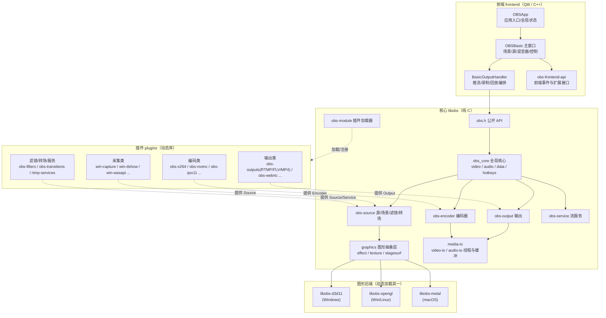
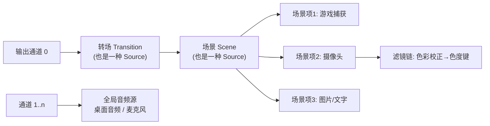
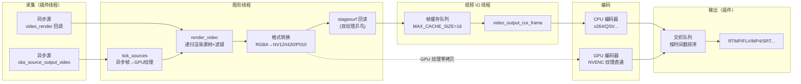
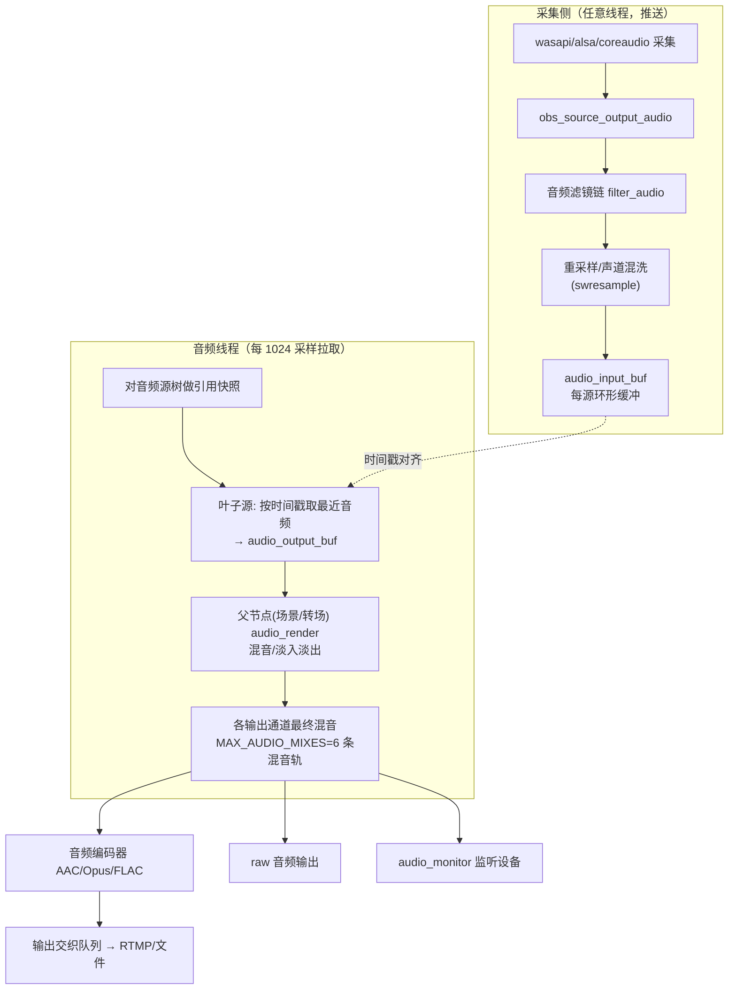
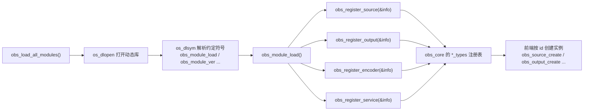

# OBS Studio 33.0.1 架构设计解析

> 本文基于源码实际结构分析，关键结论均标注了对应源码文件。
> 官方英文设计文档可对照阅读：[backend-design.rst](../obs-studio-33.0.1/docs/sphinx/backend-design.rst)、[frontends.rst](../obs-studio-33.0.1/docs/sphinx/frontends.rst)、[graphics.rst](../obs-studio-33.0.1/docs/sphinx/graphics.rst)。

## 1. 总体架构：前后端分离 + 插件化内核

OBS 采用 **"Qt 前端（frontend） + C 核心库（libobs） + 动态插件（plugins）"** 的三层架构：

- **libobs** 是纯 C 实现的核心引擎，负责音视频管线调度、图形合成、插件框架，不依赖任何 UI；
- **frontend** 是 Qt6/C++ 实现的图形界面，通过 libobs 的公开 C API（`libobs/obs.h`）与前端 API（`frontend/api/obs-frontend-api.h`）驱动核心；
- **plugins** 全部编译为动态库（.dll/.so/.dylib），运行时由 libobs 的模块加载器发现并注册，向核心贡献四类对象：**Source（源）、Output（输出）、Encoder（编码器）、Service（流服务）**。



### 1.1 设计要点

| 设计决策 | 说明 | 源码依据 |
| --- | --- | --- |
| C 内核 + C++ 前端 | 内核保持 ABI 稳定、跨平台、可被任意语言前端复用（如 obs-websocket） | `libobs/*.c` 与 `frontend/*.cpp` |
| 一切皆 Source | 场景、转场、滤镜都是 Source 的特化，形成统一的递归渲染/混音树 | `libobs/obs-source.h` 中 `enum obs_source_type` |
| 四类插件对象 | Source/Output/Encoder/Service 通过 `*_info` 回调表注册，核心按 id 查找实例化 | `libobs/obs-module.c`、`obs-internal.h` 中 `obs_core` 的 `*_types` 数组 |
| 图形后端可替换 | `graphics_t` 抽象 + 函数指针表，D3D11/OpenGL/Metal 三实现 | `libobs/graphics/graphics-imports.h`、`libobs-d3d11/`、`libobs-opengl/`、`libobs-metal/` |
| 信号/回调驱动 | 对象状态变化通过 signal_handler 广播，前端订阅而非轮询 | `libobs/callback/signal.c`、`docs/sphinx/frontends.rst` |

## 2. 核心对象模型：obs_core

全局唯一核心 `struct obs_core *obs`（`libobs/obs-internal.h`）按职责分为四个子结构：

```text
obs_core
├── video   (obs_core_video)    图形上下文、默认 effect、图形线程、视频混合器列表 mixes
├── audio   (obs_core_audio)    音频 IO、渲染顺序树 render_order/root_nodes、监听设备
├── data    (obs_core_data)     所有源/输出/编码器/服务/显示/画布的注册表（uthash + 链表 + 互斥锁）
└── hotkeys (obs_core_hotkeys)  热键注册表与热键线程
```

33.x 引入 **Canvas（画布）/ Video Mix（视频混合器）** 抽象（`libobs/obs-canvas.c`）：
每个 `obs_canvas` 持有自己的 `obs_view`（64 个输出通道）与 `obs_core_video_mix`（独立的渲染纹理、格式转换、GPU 编码队列），
支持多画布独立分辨率合成；主画布 `main_canvas` 保证整个程序生命周期存在。

### 2.1 输出通道（Output Channels）与源树

- `obs_view::channels[64]`：每个通道可挂一个源，按索引升序叠加渲染（`libobs/obs-view.c`）；
- 前端典型结构：**通道 0 = 转场 → 转场子源 = 场景 → 场景项(scene item) → 具体源**；
- 场景项 `obs_sceneitem` 只是"容器 + 变换"，同一个源可被多个场景项/场景引用（引用计数共享）；
- 全局音频源（桌面音频/麦克风）占用额外通道。



## 3. 线程模型（运行时并发架构）

libobs 初始化后常驻 **三大主线程**（官方 backend-design.rst 明确定义），辅以若干工作线程：

| 线程 | 入口函数 | 职责 | 节拍 |
| --- | --- | --- | --- |
| 图形线程 | `obs_graphics_thread`（`libobs/obs-video.c`） | tick 所有源 → 渲染各 mix 最终纹理 → 格式转换/回读 → 渲染预览 display → 执行图形任务队列 | 每帧（如 60FPS≈16.7ms） |
| 视频 IO 线程 | `video_thread`（`libobs/media-io/video-io.c`） | 从帧缓存队列取原始帧，分发给 raw 输出与视频编码器 | 帧驱动（信号量） |
| 音频线程 | `audio_thread`（`libobs/media-io/audio-io.c`） | 每 1024 采样（48kHz 下约 21.3ms）回调 `audio_callback`（`libobs/obs-audio.c`）完成树形混音并分发 | 固定音频块 |
| UI 线程 | Qt 事件循环（`frontend/obs-main.cpp`） | 界面交互；通过 `obs_queue_task` 把图形操作投递到图形线程 | 事件驱动 |
| 热键线程 | `obs_hotkey_thread`（`libobs/obs-hotkey.c`） | 全局热键轮询 | 轮询 |
| GPU 编码线程 | `obs-video-gpu-encode.c` | GPU 纹理直通编码器（零拷贝路径） | 信号量 |
| 输出内部线程 | 如 RTMP 发送线程、`end_data_capture_thread`、重连线程 | 网络发送/停止收尾/断线重连 | 各自独立 |

### 3.1 图形线程主循环（源码级）

`obs_graphics_thread_loop`（obs-video.c 第 1094 行起）每帧执行：

```text
1. update_active_states()      # 检查各 mix 是否有 raw/GPU 输出活跃
2. gs_begin_frame()            # 进入图形上下文，帧开始
3. tick_sources()              # 调用每个源的 video_tick（异步帧上屏准备、转场推进）
4. [Windows] PeekMessage 泵    # 图形线程内处理部分窗口消息
5. output_frames()             # 对每个 mix：render_video → download_frame → output_video_data
6. render_displays()           # 渲染所有预览窗口（swapchain present）
7. execute_graphics_tasks()    # 执行 UI 线程投递的图形任务
8. video_sleep()               # 高精度睡眠到下一帧时间点，统计 FPS/丢帧
```

### 3.2 线程间数据交接

- **视频**：图形线程把转换后的帧写入 `video_output` 的环形缓存（`MAX_CACHE_SIZE = 16`，video-io.c 第 35 行），post 信号量；视频 IO 线程消费。**队列满时复制上一帧**（降低编码复杂度），这就是"编码器跟不上时跳帧"的来源；
- **音频**：采集线程随时把数据写入源的 `audio_input_buf` 环形缓冲（自动重采样/混洗），音频线程按时间戳取最近样本做树形混音；
- **UI → 图形**：`obs_queue_task(OBS_TASK_GRAPHICS, ...)` 任务队列，避免跨线程直接调用图形 API；
- **图形上下文互斥**：任何线程使用 gs_* API 前必须 `obs_enter_graphics()`（`docs/sphinx/graphics.rst`）。

## 4. 视频管线架构



关键机制：

1. **同步 vs 异步源**：同步源（如图片、游戏捕获钩子）在图形线程 `video_render` 中即时绘制；异步源（摄像头、媒体播放、视频采集设备）在自己的线程产出 `obs_source_frame`，经 `obs_source_output_video` 入队，图形线程 tick 时上传为 GPU 纹理（`obs_source::async_textures`）；
2. **滤镜链**：每个源可挂滤镜源列表，视频滤镜用 `obs_source_process_filter_begin/end` 把父源渲染到纹理再叠加 shader；音频滤镜在 `obs_source_output_audio` 路径上同步处理；
3. **乒乓纹理 + 异步回读**：`NUM_TEXTURES = 2`，本帧渲染 texture[cur]，回读上一帧 texture[prev] 的 stagesurf，避免 GPU→CPU 同步等待（obs-video.c `output_frame`）；
4. **GPU 编码路径**：`obs_core_video_mix::gpu_encoder_queue` + 独立 GPU 编码线程，纹理不经过 CPU 回读直接交给 NVENC 等（`libobs/obs-video-gpu-encode.c`）；
5. **HDR/色彩管理**：`render_space`、`color_matrix`、P010/RGBA16F 支持（obs-internal.h `obs_core_video_mix`）。

## 5. 音频管线架构

音频是 **"推送入缓冲 + 拉取式树形混音"** 模型（`libobs/obs-audio.c` `audio_callback`）：



要点：

- 音量/静音/按压通话等动作带时间戳记录在 `audio_actions`，混音时按样本精确生效；
- 源在树中多次出现时通过 `audio_is_duplicated` 去重；
- 音视频同步：视频编码器与音频编码器通过 `paired_encoders`/`start_ts` 对齐起始时间戳（obs-internal.h `obs_encoder`）。

## 6. 插件框架架构



- 每个插件导出 `obs_module_load/unload/post_load/set_locale/ver` 等约定函数（`libobs/obs-module.h` 的 `MODULE_EXPORT` 宏）；
- `*_info` 结构是**纯 C 的"接口/虚表"**：`id + 回调函数指针 + 能力 flags`，核心只依赖接口不依赖实现；
- 插件可声明依赖与版本（`obs_module_metadata`），33.x 的插件管理器（`frontend/plugin-manager/`）支持第三方插件启用/禁用/安全模式；
- 对象生命周期由**强/弱引用计数**管理（`obs_weak_ref`，obs-internal.h）：`obs_source_release` 归零销毁，`obs_weak_source_get_ref` 允许安全地"尝试复活"弱引用，避免多线程悬垂指针。

## 7. 前端架构（Qt）

- `OBSApp`（QApplication 子类）：全局配置、主题、翻译、日志、崩溃处理、`OBSInit()` 启动 libobs；
- `OBSBasic`（QMainWindow）：主窗口，按功能拆分为多个分部实现文件（`OBSBasic_Streaming.cpp`、`OBSBasic_Recording.cpp`、`OBSBasic_SceneCollections.cpp` 等）；
- `BasicOutputHandler`：封装"简单/高级"两种输出模式下的推流、录制、回放缓冲、虚拟摄像头的编码器/输出/服务装配；
- `obs-frontend-api`：向前端插件（如 frontend-tools）暴露事件回调与 UI 扩展点；
- 预览渲染：`QTDisplay`/`OBSQTDisplay` 把原生窗口句柄交给 `obs_display_create`，由 libobs 图形线程直接绘制（`frontend/widgets/`）。

## 8. 架构优点与可借鉴之处

1. **接口与实现彻底解耦**：C 回调表 + 动态加载，使 40+ 插件与三套图形后端互不感知；
2. **确定性节拍**：图形线程按帧、音频线程按固定采样块，时间戳贯穿全管线，天然支持音画同步与丢帧统计；
3. **生产者/消费者缓冲 everywhere**：异步视频帧队列、音频环形缓冲、视频帧缓存、输出交织队列、延迟队列（`obs-output-delay.c`），线程间只传数据不传调用；
4. **零拷贝演进**：GPU 编码路径、共享纹理捕获（win-capture 的 D3D11 共享句柄）持续减少 CPU 参与；
5. **可观测性内建**：profiler、source-profiler（每源 tick/render 耗时与 GPU 计时）、丢帧/滞后帧计数直接暴露在核心结构中。