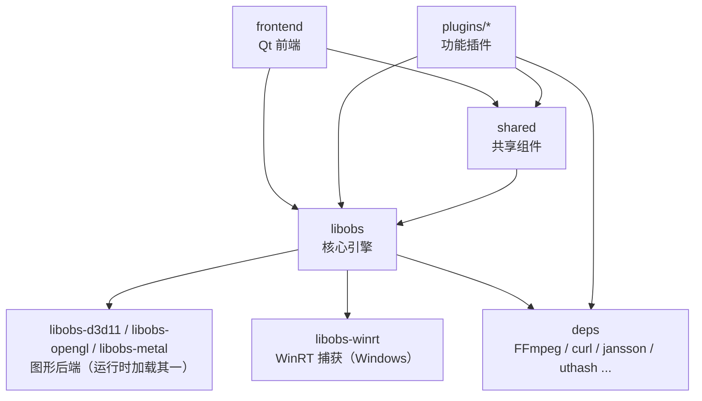

# OBS Studio 33.0.1 模块划分解析

> 本文按"核心库 → 图形后端 → 前端 → 插件 → 共享组件 → 构建/依赖"的顺序逐模块说明职责、关键文件与依赖关系。

## 1. 模块总览与依赖关系

依赖方向严格单向：**前端/插件 → libobs → 图形后端/系统库**。libobs 不反向依赖前端，前端通过 `obs-frontend-api` 与信号机制获得扩展能力。

## 2. libobs —— 核心引擎

纯 C 实现，是整个 OBS 的"操作系统内核"。内部可再分为 6 个子模块：

### 2.1 核心对象与管线调度（根目录 *.c/*.h）

| 文件 | 职责 |
| --- | --- |
| `obs.c / obs.h` | 全局初始化 `obs_startup/obs_shutdown`、`obs_reset_video/audio`、公开 API 总入口 |
| `obs-internal.h` | 核心私有结构：`obs_core`、`obs_source`、`obs_output`、`obs_encoder`、`obs_service`、引用计数 |
| `obs-video.c` | **图形线程主循环**：tick 源、渲染 mix、格式转换、回读、预览渲染 |
| `obs-audio.c` | **音频回调**：源树快照、树形混音、最终混音分发 |
| `obs-audio-controls.c` | 音量/静音/平衡/按压通话等音频控制 |
| `obs-source.c` | 源生命周期、滤镜链、异步视频帧处理、音频缓冲 |
| `obs-scene.c` | 场景与场景项（变换/裁剪/排序/分组） |
| `obs-source-transition.c` | 转场基类：双源切换、淡入淡出、手动转场 |
| `obs-source-deinterlace.c` | 异步视频去隔行（Yadif 等） |
| `obs-output.c` | 输出生命周期、编码器绑定、**交织队列**、暂停/重连 |
| `obs-output-delay.c` | 输出延迟（流延迟功能） |
| `obs-encoder.c` | 编码器生命周期、原始帧→编码包、音视频起始对齐、编码器组 |
| `obs-video-gpu-encode.c` | GPU 纹理直通编码线程（零拷贝） |
| `obs-service.c` | 流服务（URL/密钥/协议参数） |
| `obs-canvas.c / obs-view.c` | 画布与 64 输出通道视图（33.x 多画布） |
| `obs-display.c` | 预览显示（swapchain + 绘制回调） |
| `obs-module.c` | 插件动态加载与四类对象注册表 |
| `obs-data.c` | `obs_data_t`：JSON 式键值设置对象（对象持久化基础） |
| `obs-properties.c` | `obs_properties_t`：插件向 UI 声明设置控件 |
| `obs-hotkey.c` | 热键注册/绑定/线程 |
| `obs-avc.c / obs-hevc.c / obs-av1.c / obs-nal.c` | 码流解析辅助（关键帧/SPS/PPS/NAL） |
| `obs-missing-files.c` | 场景集合缺失文件检测 |

### 2.2 graphics/ —— 图形抽象层

- `graphics.h` + `graphics-imports.h`：定义 `gs_*` API 与后端函数指针表；
- `effect.c / effect-parser.c`：类 HLSL 的 effect 文件解析（uniform/sampler/technique/pass）；
- `matrix4 / quat / vec2-4 / axisang`：数学库；
- `image-file.c`：CPU 图像加载；`texture-render.c`：离屏渲染目标；
- `device.c`：后端设备枚举与加载。

### 2.3 media-io/ —— 音视频 IO

| 文件 | 职责 |
| --- | --- |
| `video-io.c` | 视频 IO 线程、帧缓存队列（16 帧）、raw/编码器分发 |
| `audio-io.c` | 音频线程（1024 采样/tick）、混音分发 |
| `audio-resampler-ffmpeg.c` | swresample 重采样封装 |
| `video-scaler-ffmpeg.c` | swscale 缩放封装 |
| `format-conversion.c` | 像素格式转换 |
| `video-frame.c / video-matrices.c` | 帧对齐分配、色彩矩阵 |
| `media-remux.c` | 媒体重混（回放缓冲用） |

### 2.4 callback/ —— 信号与过程

- `signal.c`：发布/订阅信号（`signal_handler_connect/signal`），对象状态通知；
- `proc.c`：过程调用表（`proc_handler_call`），对象对外暴露可调用方法；
- `calldata.c`：回调参数封装。

### 2.5 util/ —— 基础设施

内存（`bmem.c` 带泄漏计数）、线程原语（`threading*.c`）、动态数组/双端队列（`darray.h`/`deque.c`）、字符串（`dstr.c`）、配置（`config-file.c`）、日志（`base.c` blog）、平台抽象（`platform.c`、`windows/`）、性能分析（`profiler.c`、`source-profiler.c`）、序列化、任务队列（`task.c`）、curl 封装等。

### 2.6 audio-monitoring/ —— 音频监听

按平台（win/mac/linux）实现把源音频送到本地监听设备。

## 3. 图形后端模块

| 模块 | 平台 | 说明 |
| --- | --- | --- |
| `libobs-d3d11/` | Windows | 主力后端。`d3d11-subsystem.cpp` 实现设备/交换链；`d3d11-shaderprocessor` 把 effect 翻译为 HLSL；`d3d11-duplicator` 支持 DXGI 桌面复制 |
| `libobs-opengl/` | Windows/Linux | GL 后端，`gl-shaderparser` 翻译 effect 为 GLSL；支持 EGL/X11/Wayland |
| `libobs-metal/` | macOS | 33.x 新增 Swift 实现的 Metal 后端（`metal-subsystem.swift` 等） |
| `libobs-winrt/` | Windows | WinRT `Windows.Graphics.Capture` 捕获与 Dispatcher 辅助，被图形线程按需 `os_dlopen` |

三者实现同一套 `gs_*` 函数表，libobs 启动时按 `obs_video_info::graphics_module` 加载。

## 4. frontend —— Qt 前端

| 子目录/文件 | 职责 |
| --- | --- |
| `obs-main.cpp` | 进程入口：命令行解析、日志、单实例、崩溃处理、`main()` |
| `OBSApp.cpp/.hpp` | QApplication 子类：配置/主题/翻译/`OBSInit()` |
| `OBSStudioAPI.cpp` | 实现 obs-frontend-api，向前端插件暴露能力 |
| `widgets/` | 主窗口 `OBSBasic`（按功能拆分 40+ 分部文件）、预览 `OBSQTDisplay`、源工具栏等 |
| `dialogs/` | 设置、源属性、滤镜、转场、缺失文件、名称编辑等 40 个对话框 |
| `settings/` | 设置页（视频/音频/输出/推流/热键/高级） |
| `components/` | 可复用 UI 组件（音量条、源树、场景集合、多轨音频等） |
| `models/` | Qt 模型（源/场景列表） |
| `utility/` | 前端工具（输出编排 `BasicOutputHandler`、`SimpleOutput`/`AdvancedOutput`、显示辅助等 113 文件） |
| `api/` | `obs-frontend-api.h`：前端插件 API 与事件定义 |
| `plugin-manager/` | 第三方插件发现/启用/禁用/安全模式 |
| `oauth/` | Twitch/YouTube/Restream 登录授权 |
| `importers/` | 从 XSplit/Streamlabs 等导入配置 |
| `updater/` | 自动更新 |
| `wizards/` | 自动配置向导（带宽测试/编码器选择） |
| `forms/` | Qt Designer .ui 文件 |

## 5. plugins —— 功能插件清单

按贡献的对象类型分类（每个插件都是独立动态库）：

### 5.1 采集类（提供 Source）

| 插件 | 平台 | 提供的源 |
| --- | --- | --- |
| `win-capture` | Win | 游戏捕获（注入钩子）、窗口/显示器捕获（BitBlt/WGC）、DC 捕获 |
| `win-dshow` | Win | DirectShow 摄像头/采集卡 |
| `win-wasapi` | Win | WASAPI 桌面音频/麦克风 |
| `image-source` | 全 | 图片、图片幻灯片 |
| `obs-text` / `text-freetype2` | 全 | GDI+/FreeType 文字源 |
| `vlc-video` | 全 | VLC 媒体源（多格式播放） |
| `obs-ffmpeg` | 全 | FFmpeg 媒体源、NVENC/AAF 等（也含编码/输出） |
| `obs-browser` | 全 | CEF 浏览器源（子模块，本包未含） |
| `linux-capture` / `linux-pipewire` / `linux-v4l2` / `linux-alsa` / `linux-pulseaudio` / `linux-jack` | Linux | X11/PipeWire 捕获、V4L2、音频 |
| `mac-capture` / `mac-avcapture` / `mac-syphon` | macOS | 屏幕/窗口/摄像头/Syphon |
| `aja` / `decklink` | 全 | AJA/Blackmagic 专业采集卡（含配套输出 UI 插件） |
| `oss-audio` / `sndio` | BSD | 音频采集 |

### 5.2 编码类（提供 Encoder）

| 插件 | 编码器 |
| --- | --- |
| `obs-x264` | x264（H.264 CPU） |
| `obs-nvenc` | NVIDIA NVENC（H.264/HEVC/AV1） |
| `obs-qsv11` | Intel QuickSync（含 oneVPL） |
| `mac-videotoolbox` | Apple VideoToolbox |
| `coreaudio-encoder` | macOS CoreAudio AAC |
| `obs-libfdk` | Fraunhofer FDK AAC |
| `obs-ffmpeg` | FFmpeg 系编码（含 AAC/ALAC/FLAC/PCM 等） |

### 5.3 输出类（提供 Output）

| 插件 | 输出 |
| --- | --- |
| `obs-outputs` | RTMP 推流、FLV/MP4/MOV/MKV/TS 录制、SRT/RIST 推流 |
| `obs-webrtc` | WHIP/WebRTC 推流 |
| `mac-virtualcam` | macOS 虚拟摄像头 |
| `aja-output-ui` / `decklink-output-ui` | 专业卡输出 |

### 5.4 滤镜/转场/服务/工具

| 插件 | 内容 |
| --- | --- |
| `obs-filters` | 色彩校正、色度键、裁剪、锐化、降噪（RNNoise）、压缩器、限幅器、增益、VST 前置、滚动/异步延迟等 |
| `obs-transitions` | 淡入淡出、剪切、滑动、擦除、亮度擦除、Stinger 等转场 |
| `obs-vst` | VST 2.x 音频插件宿主 |
| `nv-filters` | NVIDIA RTX 视频降噪/背景去除（需 RTX SDK） |
| `rtmp-services` | 推流服务列表（Twitch/YouTube/自定义 RTMP…）与服务器测速 |
| `frontend-tools` | 输出计时器、自动场景切换、脚本（Lua/Python）支持 |
| `decklink-captions` | Decklink 字幕 |

## 6. shared —— 前后端共享组件

| 目录 | 职责 |
| --- | --- |
| `properties-view` | 把 `obs_properties_t` 自动渲染为 Qt 设置界面（插件设置 UI 的通用引擎） |
| `media-playback` | 基于 FFmpeg 的媒体解码播放（媒体源/VLC 之外通用） |
| `obs-scripting` | Lua/Python 脚本绑定 |
| `ipc-util` / `obs-shared-memory-queue` / `obs-inject-library` / `obs-hook-config` / `obs-d3d8-api` | 游戏捕获配套：进程间通信、共享内存帧队列、DLL 注入、D3D8 转接 |
| `qt` | Qt 通用包装（显示控件基类等） |
| `file-updater` / `happy-eyeballs` / `bpm` / `opts-parser` / `obs-tiny-nv12-scale` | 文件更新、双栈连接、BPM 检测、参数解析、NV12 缩放 |

## 7. 构建与依赖

- `CMakeLists.txt` + `CMakePresets.json`：顶层构建，预设覆盖 windows-x64 / macos / linux；
- `cmake/`：`finders/`（35 个依赖查找器）、`common/`（编译选项）、平台子目录、`bundle/`（macOS 打包）；
- `deps/`：git 子模块依赖（libff、curl、jansson、obs-browser、obs-websocket 等；zip 源码包中为空目录，需另行获取）；
- `test/`：libobs 单元测试（CMake/CTest）；
- `.github/workflows/`：官方 CI 构建脚本，可作为本地构建参考。

## 8. 模块阅读路线建议

1. **先读接口**：`libobs/obs.h` → `obs-source.h` → `obs-output.h` → `obs-encoder.h`（公开 API 与插件接口）；
2. **再读主干**：`obs.c`（初始化）→ `obs-video.c`（图形循环）→ `obs-audio.c`（混音）→ `media-io/video-io.c`；
3. **看一个完整插件**：`plugins/image-source/`（最简单的 Source）→ `plugins/obs-x264/`（Encoder）→ `plugins/obs-outputs/rtmp-stream.c`（Output）；
4. **最后看前端装配**：`frontend/obs-main.cpp` → `OBSApp::OBSInit` → `OBSBasic::OBSInit` → `utility/BasicOutputHandler`。