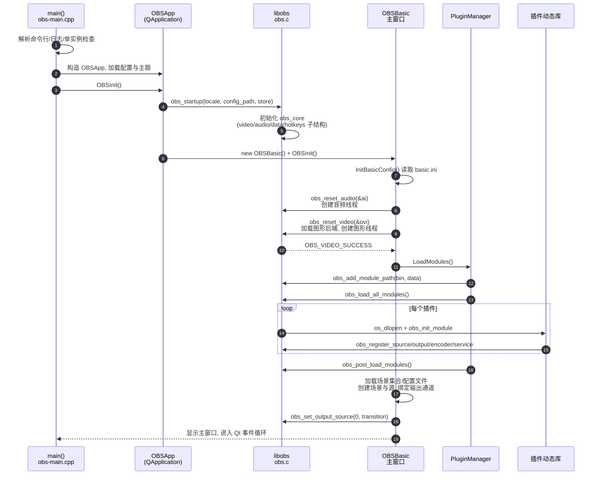
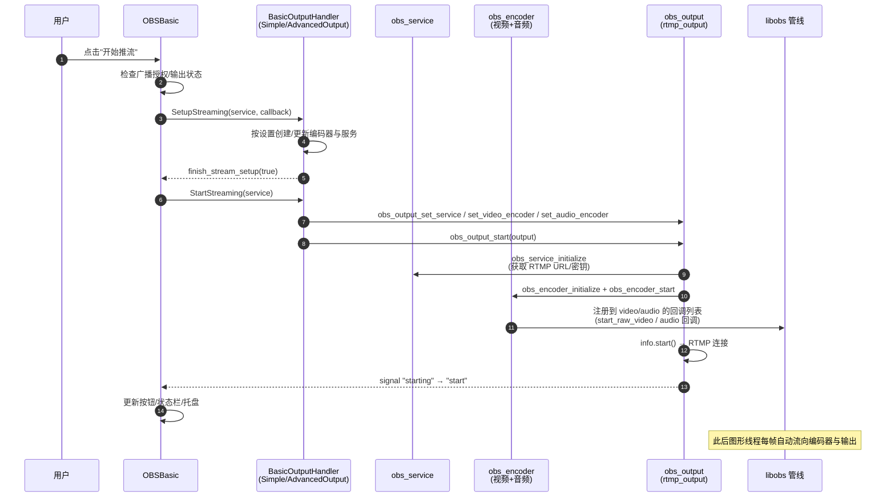
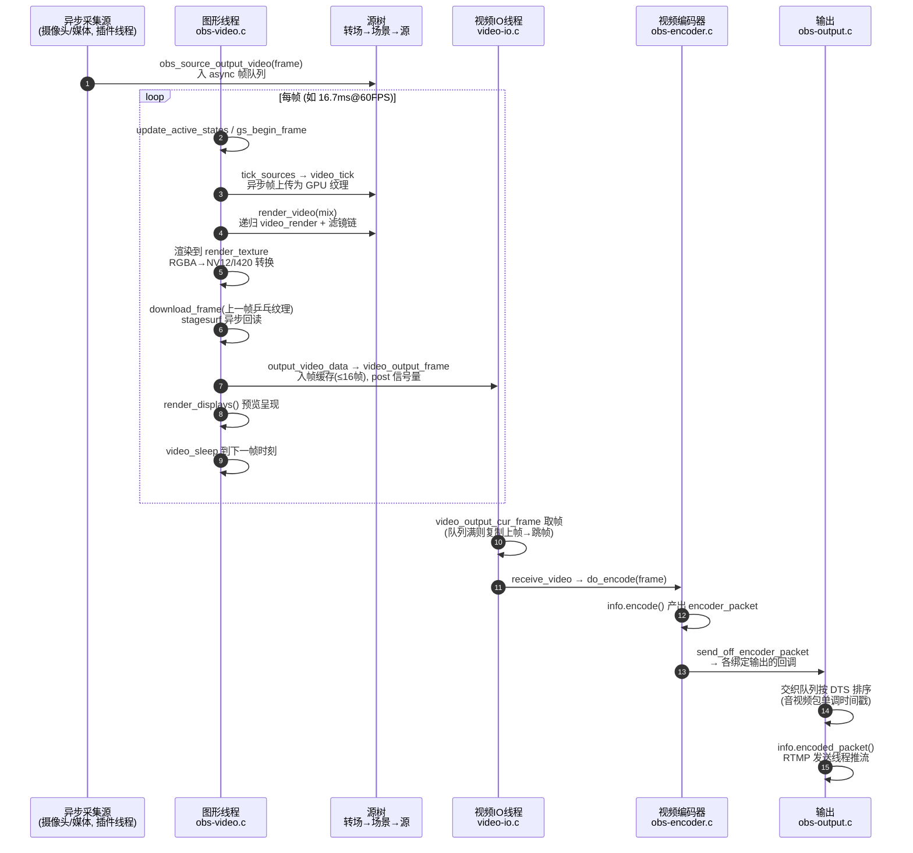
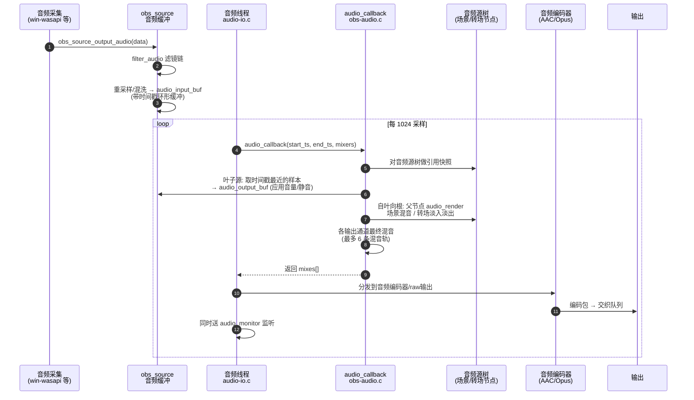
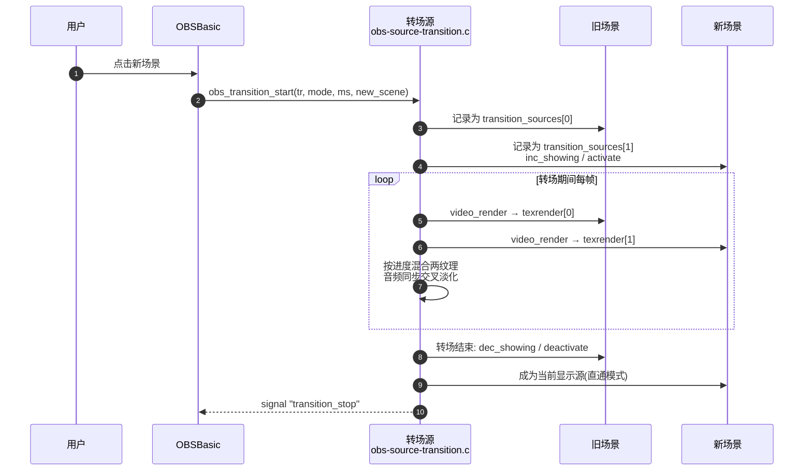
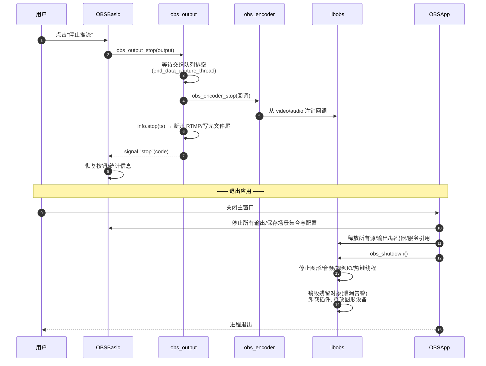
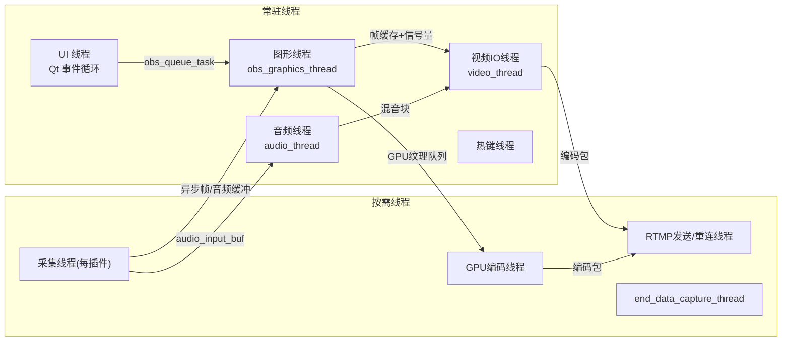

# OBS Studio 33.0.1 软件时序图解析

> 本文用 Mermaid 时序图描述 OBS 运行期的关键交互流程，全部基于源码实际调用链。
> 在支持 Mermaid 的 Markdown 查看器（VS Code + Mermaid 插件 / GitHub / Typora）中可直接渲染。

## 1. 应用启动与初始化时序

入口：`frontend/obs-main.cpp` `main()` → `OBSApp::OBSInit()`（OBSApp.cpp:1274）→ `OBSBasic::OBSInit()`（widgets/OBSBasic.cpp:874）。

要点：

- `obs_reset_video` 之后**图形线程已常驻运行**（即使没有输出，也在渲染预览）；
- 音频先于视频初始化（OBSBasic.cpp:881-887）；
- 插件加载失败/第三方插件可通过安全模式跳过（`plugin-manager/`）。

## 2. 开始推流时序

入口：`OBSBasic::StartStreaming()`（widgets/OBSBasic_Streaming.cpp:48）→ `BasicOutputHandler::StartStreaming`。

要点：

- 输出启动后**自动开始捕获**当前输出通道上的画面与音频（frontends.rst 明确说明）；
- 失败时 output 发出带错误码的 `stop` 信号，前端经 `obs_output_get_last_error()` 展示；
- 录制/回放缓冲可随推流联动启动（`RecordWhenStreaming` 等配置）。

## 3. 视频帧管线时序（每帧）

图形线程：`obs_graphics_thread_loop`（obs-video.c:1094）；视频 IO 线程：`video_thread`（media-io/video-io.c:190）。

要点：

- **双纹理乒乓**（`NUM_TEXTURES=2`）：本帧渲染 cur，回读 prev，隐藏 GPU→CPU 延迟；
- GPU 编码器走旁路：纹理直接入 `gpu_encoder_queue`，由 GPU 编码线程处理，不经回读；
- 一个编码器可服务多个输出（`obs_encoder::outputs` 数组），编码只做一次。

## 4. 音频混音时序（每 1024 采样 ≈ 21.3ms@48kHz）

音频线程：`audio_thread`（media-io/audio-io.c）→ `audio_callback`（obs-audio.c）。

## 5. 场景切换（转场）时序

## 6. 停止推流与关闭时序

## 7. 线程全景（静态对照）

> 注：音频编码器实际由音频线程直接驱动（audio-io 分发），图中 AT→VT 仅表示编码包最终在输出交织队列汇合。