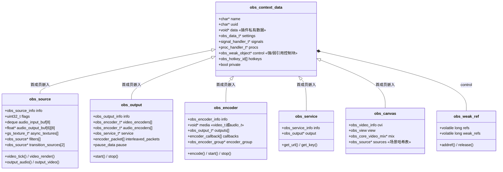
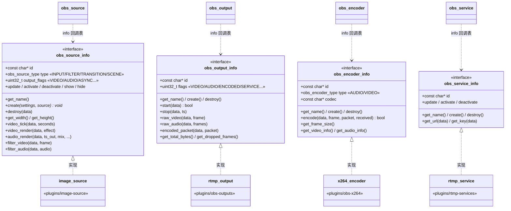
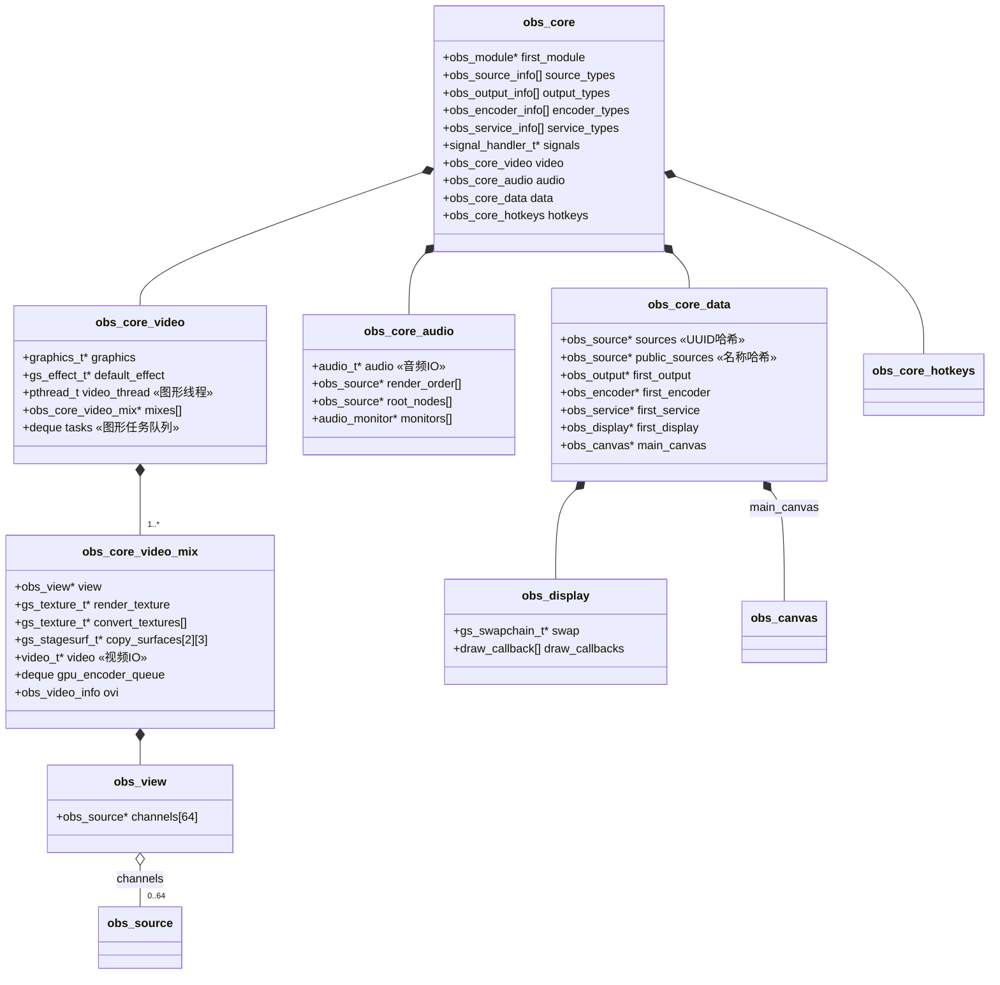
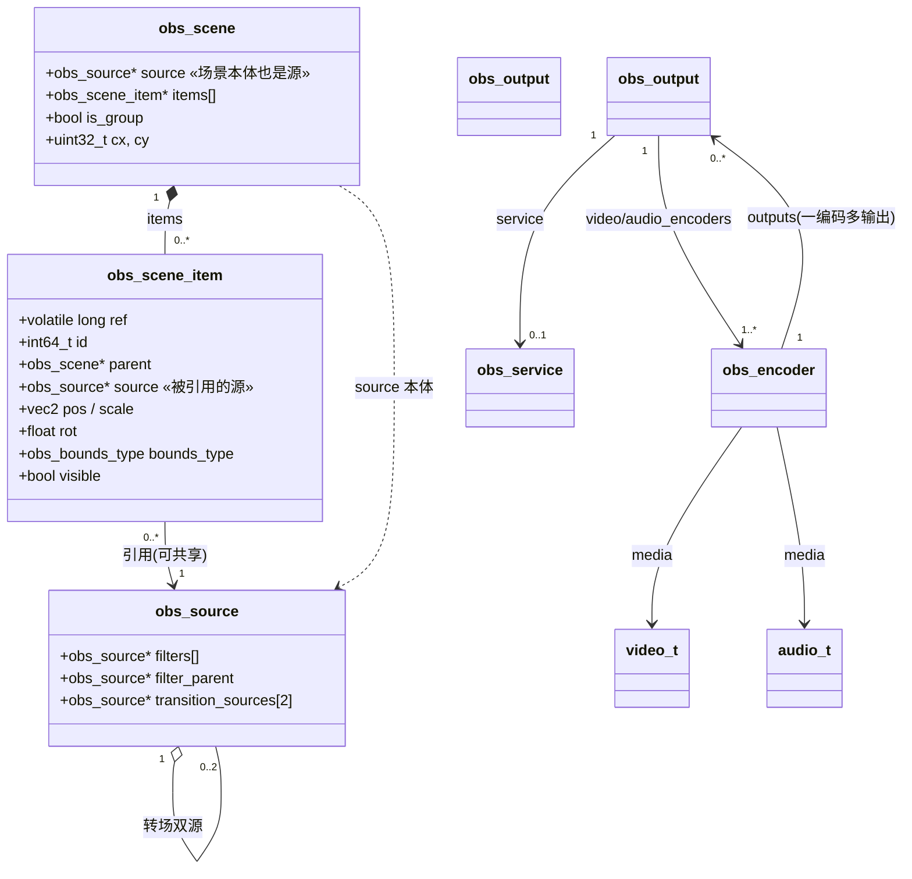
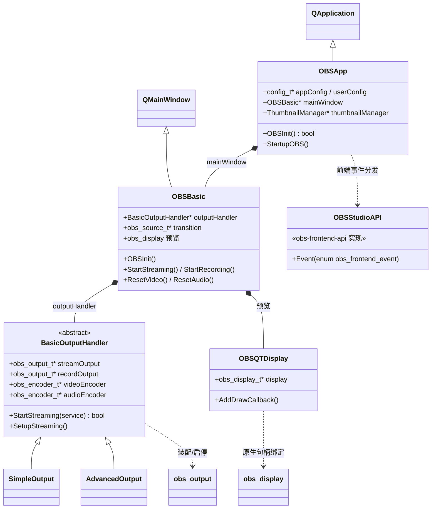

# OBS Studio 33.0.1 类图设计解析

> libobs 是纯 C 实现，没有语言级"类"，但通过 **结构体嵌入（组合式继承）+ 回调表（接口/虚表）+ 引用计数** 实现了完整的面向对象设计。
> 本文用 UML 类图表达这些结构关系，字段均取自 `libobs/obs-internal.h`、`obs-source.h`、`obs-output.h`、`obs-encoder.h`、`obs-scene.h`。

## 1. 核心对象体系：obs_context_data "基类"

所有可命名、可持久化、可发信号的核心对象都内嵌 `obs_context_data`（C 风格继承：首成员嵌入）：

### 1.1 引用计数设计

- `obs_weak_ref` 同时维护**强引用 refs** 与**弱引用 weak_refs**；
- 强引用归零 → 调用 `destroy` 销毁对象；弱引用允许其他线程 `obs_weak_source_get_ref()` 原子地"尝试获取强引用"，失败说明对象已销毁——这是多线程下对象安全共享的关键；
- 每类对象有对应弱句柄：`obs_weak_source / obs_weak_output / obs_weak_encoder / obs_weak_service / obs_weak_canvas`。

## 2. 插件接口（C 语言"虚表"）

四类 `*_info` 结构是插件必须实现的接口，核心通过 id 在注册表中查找并调用：

> `obs_source_info.type` 决定源的行为分支：SCENE/TRANSITION 由 libobs 内建实现（`obs-scene.c`、`obs-source-transition.c`），插件一般实现 INPUT 与 FILTER。

## 3. 全局核心 obs_core 组合关系

## 4. 场景树与对象协作关系

> 注意 `obs_scene` 与 `obs_source` 是**双向关联**：场景持有其源本体指针，源（type=SCENE）的插件私有数据指向场景。场景项只是"变换容器"，同一源可被多个场景项引用，靠引用计数共享。

## 5. 前端 Qt 类关系

## 6. 设计模式总结

| 模式 | 在 OBS 中的体现 |
| --- | --- |
| 接口/虚表（策略） | `*_info` 回调表：核心面向接口编程，插件提供实现 |
| 组合式继承 | `obs_context_data` 首成员嵌入五大对象；`obs_scene` 复用 `obs_source` |
| 注册表 + 工厂 | `obs_core::*_types` 按 id 注册，`obs_*_create` 工厂实例化 |
| 观察者 | `signal_handler` 信号订阅（output start/stop、source create/destroy…） |
| 生产者-消费者 | 异步帧队列、音频环形缓冲、视频帧缓存、交织队列 |
| 享元/共享引用 | 场景项共享同一源；弱引用控制块跨线程安全访问 |
| 代理 | `obs_canvas` 代理 view + video mix；`obs_weak_*` 代理对象访问 |
| 模板方法 | 图形主循环固定骨架（tick→render→output→display），源回调填充细节 |