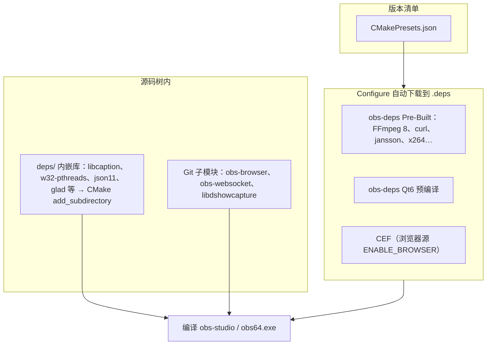

# Windows 上编译指定版本 OBS（以 33.0.1 为例）

本文说明如何在本仓库 [`obs-studio-33.0.1/`](../obs-studio-33.0.1/) 对应版本下，于 **Windows x64** 从源码构建 OBS。**不要求**提前手抄全部第三方库 URL：官方 CMake 在 Configure 阶段会按版本清单自动下载预编译包。下文以只读调研结论整理流程，**不包含**替你下载依赖或实机编译。

> **与发行版调试的关系**：若目标是对照源码调试，可不走编译，直接使用 GitHub 发行版 + PDB，见 [06-官方PDB与VS调试.md](./06-官方PDB与VS调试.md)。若需要**各插件完整符号**或改代码验证，应本地自编译，见本文第六节。

---

## 一、能否直接用 CMake 构建？

**可以。** 33.0.1 官方入口是 **CMake Presets**（与 CI 相同套路）：

```powershell
cd obs-studio-33.0.1
cmake --preset windows-x64
cmake --build --preset windows-x64 --config RelWithDebInfo --parallel
```

- **Configure**（第一条命令）：生成 `build_x64/`，并执行依赖检查/下载。
- **Build**：`buildPresets` 里 `windows-x64` 默认配置类型为 **`RelWithDebInfo`**（见 [`CMakePresets.json`](../obs-studio-33.0.1/CMakePresets.json)）。

CI 使用更严的 `windows-ci-x64` preset（如将警告视为错误），见 [`.github/scripts/Build-Windows.ps1`](../obs-studio-33.0.1/.github/scripts/Build-Windows.ps1)。本地开发一般用 **`windows-x64`** 即可。

等价手工调用（生成器须与 preset 一致，见下文 VS 版本说明）：

```powershell
cmake -S . -B build_x64 -G "Visual Studio 18 2026" -A x64
cmake --build build_x64 --config RelWithDebInfo --parallel
```

Configure 时 [`cmake/windows/buildspec.cmake`](../obs-studio-33.0.1/cmake/windows/buildspec.cmake) 引入 [`cmake/common/buildspec_common.cmake`](../obs-studio-33.0.1/cmake/common/buildspec_common.cmake) 中的 **`_check_dependencies`**：从网络下载、校验 **SHA256**、解压到源码根下 **`.deps/`**，并把路径写入 **`CMAKE_PREFIX_PATH`**。

---

## 二、编译指定版本时如何对齐？

| 层级 | 做法 |
| --- | --- |
| OBS 源码 | 使用与目标一致 Git **tag**（本仓库为 **33.0.1**）。推荐 `git clone --recursive` 后 `git checkout 33.0.1`。 |
| 依赖版本 | **不要**混用 master 源码 + 旧版 deps。版本锁在**该 tag 内**的 [`CMakePresets.json`](../obs-studio-33.0.1/CMakePresets.json) → `configurePresets` 中名为 `dependencies` 的 `vendor.obsproject.com/obs-studio.dependencies` 节点。 |
| 33.0.1 锁定值（Windows x64） | **obs-deps / Qt6 包日期**：`2026-10-23`；**CEF**：`7871`；各包 **SHA256** 写在同一 JSON 内。 |
| 子模块提交 | [`.gitmodules`](../obs-studio-33.0.1/.gitmodules) 中的提交由 tag 树记录；须 **`--recursive`** 拉取。 |

**本仓库注意**：若源码来自 GitHub **`archive/.../33.0.1.zip`** 解压，**通常不含 git 子模块内容**（如 `plugins/obs-browser`、`plugins/obs-websocket`、`deps/libdshowcapture/src`）。此类副本**不能直接完整编译**，需改用：

```powershell
git clone --recursive https://github.com/obsproject/obs-studio.git
cd obs-studio
git checkout 33.0.1
```

或在已有 git 仓库中：`git submodule update --init --recursive`。

---

## 三、第三方依赖从哪里来？

### 3.1 三类依赖



### 3.2 对照表

| 类别 | 在哪里找 | 33.0.1 如何确保版本正确 | 要不要自己编译 |
| --- | --- | --- | --- |
| 版本清单 | `CMakePresets.json` | 与 tag 同源文件 | 否 |
| 大型预编译包 | [obsproject/obs-deps Releases](https://github.com/obsproject/obs-deps/releases) | URL = preset 中 `baseUrl` + `version` + 固定文件名；Configure 自动下载 | **不必**从源码编 FFmpeg/Qt |
| CEF | `cdn-fastly.obsproject.com/downloads` | preset 内 `cef.hashes.windows-x64` | 解压即用（启用浏览器时） |
| `deps/` 小库 | 随 obs-studio 源码 | 与 tag 一致 | 随主工程 **一起编译** |
| Git 子模块 | `.gitmodules` | `git checkout` + `submodule update` | 作为插件/库 **编入工程** |

### 3.3 Configure 之后 `.deps/` 大致长什么样

（路径相对于 `obs-studio-33.0.1/` 根目录）

```text
.deps/
├── obs-deps-2026-10-23-x64/          # Pre-Built（FFmpeg、curl 等），加入 CMAKE_PREFIX_PATH
├── obs-deps-qt6-2026-10-23-x64/      # Qt6 预编译，加入 CMAKE_PREFIX_PATH
├── cef_binary_7871_windows_x64/        # CEF（若 ENABLE_BROWSER）
├── .dependency_prebuilt_x64.sha256     # 缓存校验标记
└── （下载中的 *.zip）
```

成功时 CMake 输出类似：

`Setting up Pre-Built obs-deps (x64) - done`  
`Setting up Pre-Built Qt6 (x64) - done`  
（浏览器开启时）`Setting up Chromium Embedded Framework (x64) - done`

### 3.4 手动提供依赖（跳过自动下载）

若已解压过 obs-deps / Qt6，可将目录加入 **`CMAKE_PREFIX_PATH`**（Configure 参数 `-DCMAKE_PREFIX_PATH="D:/path/obs-deps;D:/path/qt6"`），且包内存在 **`share/obs-deps/VERSION`**，其版本须与 preset 一致（见 `buildspec_common.cmake` 中 `_check_deps_version`）。

CMake 各 `Find*.cmake`（如 [`FindFFmpeg.cmake`](../obs-studio-33.0.1/cmake/finders/FindFFmpeg.cmake)）失败时常提示：

> Ensure that obs-deps is provided as part of CMAKE_PREFIX_PATH.

含义：**Configure 阶段未把预编译依赖布置好**，不是 libobs 源码本身缺文件。

---

## 四、前置环境（Windows）

| 项 | 要求 |
| --- | --- |
| CMake | **≥ 3.28**（见根 [`CMakeLists.txt`](../obs-studio-33.0.1/CMakeLists.txt)） |
| Visual Studio | Preset 指定生成器 **`Visual Studio 18 2026`**（VS 2026）。仅安装 VS 2022 时，需安装 VS 2026 或**本地修改** `CMakePresets.json` 中 `generator`（自行承担与上游不一致风险）。 |
| Git | 拉取子模块 |
| 磁盘 / 网络 | `.deps` 与 `build_x64` 体积大；首次 Configure 需稳定外网下载 |
| 可选环境变量 | Preset `environmentVars`：`TWITCH_*`、`YOUTUBE_*` 等 — 仅影响服务集成 OAuth，**非编译必需** |

Windows x64 完整依赖列表（Configure 后）包括 **Qt6**、**FFmpeg 8.x**（`libobs` 中 `find_package(FFmpeg 8.0 REQUIRED ...)`）及 `cmake/finders` 所列的 jansson、x264、curl 等，均由 **obs-deps 预编译包** 提供，**无需**在本地从 FFmpeg/Qt 源码逐编（除非你有特殊定制需求）。

---

## 五、推荐构建步骤（CMake Presets）

### 本仓库一键脚本（VS 2026 · 推荐）

在 **Obs-Study 根目录** 执行（内部 `cmake --preset windows-x64`，再按配置编译）：

| 脚本 | CMake 配置 | 适用场景 |
| --- | --- | --- |
| [`scripts/build-obs-windows-RelWithDebInfo.ps1`](../scripts/build-obs-windows-RelWithDebInfo.ps1) | RelWithDebInfo | 与官方 buildPresets 默认一致，带符号、体积适中 |
| [`scripts/build-obs-windows-Debug.ps1`](../scripts/build-obs-windows-Debug.ps1) | Debug | 全符号单步调试，编译慢、输出大 |

```powershell
.\scripts\build-obs-windows-RelWithDebInfo.ps1
.\scripts\build-obs-windows-Debug.ps1

# 强制重新 Configure（例如改了 CMakeLists 或清过 .deps）
.\scripts\build-obs-windows-Debug.ps1 -Reconfigure

# 已 Configure 过，只重编
.\scripts\build-obs-windows-RelWithDebInfo.ps1 -SkipConfigure
```

说明见 [`scripts/README.md`](../scripts/README.md)。Visual Studio **多配置** 生成器下，**RelWithDebInfo 与 Debug 共用同一** `build_x64` 目录，仅 `cmake --build --config` 不同。

### 手工命令（等价）

```powershell
# 1. 保证源码 + 子模块齐全（见第二节）
cd obs-studio-33.0.1

# 2. 配置（下载 .deps，生成 VS 解决方案）
cmake --preset windows-x64

# 3. 编译（RelWithDebInfo 与 preset 一致）
cmake --build --preset windows-x64 --config RelWithDebInfo --parallel
# Debug：cmake --build build_x64 --config Debug --parallel

# 4.（可选）安装到 build_x64/install — CI 打包会用类似步骤
cmake --install build_x64 --config RelWithDebInfo
```

### 输出位置

| 产物 | 典型路径 |
| --- | --- |
| 构建树 | `obs-studio-33.0.1/build_x64/` |
| 运行时布局（开发） | `build_x64/rundir`（[`cmake/windows/defaults.cmake`](../obs-studio-33.0.1/cmake/windows/defaults.cmake) 中 `OBS_OUTPUT_DIR`） |
| 主程序名 | **`obs64.exe`**（`frontend` 目标 `OUTPUT_NAME`，见 [`frontend/CMakeLists.txt`](../obs-studio-33.0.1/frontend/CMakeLists.txt)） |

在 Visual Studio 中：**文件 → 打开 → CMake** 打开 `obs-studio-33.0.1` 文件夹，选择 preset `windows-x64`，生成完成后可将 **自编译的 `obs64.exe`** 作为调试目标（符号优于官方 Release PDB）。

---

## 六、如何确认依赖与编译成功？

| 阶段 | 检查点 |
| --- | --- |
| 子模块 | 存在 `plugins/obs-browser`、`plugins/obs-websocket` 等且含 `CMakeLists.txt` |
| Configure | 日志中 obs-deps / Qt6 / CEF 为 **done**；无 `Unable to download`、`FATAL_ERROR` |
| Configure | `build_x64/` 下已生成解决方案或 Ninja 文件 |
| Build | 编译结束退出码 0；生成 `obs64.exe`（可在 `build_x64` 或 `rundir` 下搜索） |
| 运行 | 从 `rundir` 对应 `bin/64bit` 启动，能打开主界面（首次可能缺用户配置，属正常） |

---

## 七、常见问题

| 现象 | 可能原因 | 处理 |
| --- | --- | --- |
| Configure 找不到 FFmpeg / Qt | 未下载 obs-deps 或 SHA 校验失败 | 检查网络；删除 `.deps` 中对应目录后重跑 Configure；或手动设置 `CMAKE_PREFIX_PATH` |
| 插件目录为空 | zip 源码无子模块 | `git submodule update --init --recursive` |
| preset 报 VS 18 找不到 | 未装 VS 2026 | 安装 VS 2026 或改 preset 生成器 |
| 想与官方 33.0.1 二进制逐字节一致 | 自编译 ≠ 官方打包 | 对齐 **tag + RelWithDebInfo/Release** 与 **同一 obs-deps 日期**；打包还涉及签名与 CI 脚本，不必强求一致 |
| 只分析源码、不构建 | 无此需求 | 用 [06-官方PDB与VS调试.md](./06-官方PDB与VS调试.md) 调官方 exe |

---

## 八、参考链接与仓库内脚本

| 资源 | 链接 |
| --- | --- |
| 安装已编译包（非构建） | [Install-Instructions Wiki](https://github.com/obsproject/obs-studio/wiki/Install-Instructions) |
| obs-studio 仓库 | <https://github.com/obsproject/obs-studio> |
| obs-deps 预编译发布 | <https://github.com/obsproject/obs-deps/releases> |
| 本仓库 CI Windows 构建 | [`.github/scripts/Build-Windows.ps1`](../obs-studio-33.0.1/.github/scripts/Build-Windows.ps1) |
| 依赖下载实现 | [`cmake/common/buildspec_common.cmake`](../obs-studio-33.0.1/cmake/common/buildspec_common.cmake)、[`cmake/windows/buildspec.cmake`](../obs-studio-33.0.1/cmake/windows/buildspec.cmake) |

## 九、与本仓库其它文档

| 文档 | 关系 |
| --- | --- |
| [README.md](../README.md) | 构建摘要与文档索引 |
| [06-官方PDB与VS调试.md](./06-官方PDB与VS调试.md) | 不编译、调试 GitHub 发行版 + PDB |
| [01-架构设计.md](./01-架构设计.md) | 理解编译产物模块划分 |